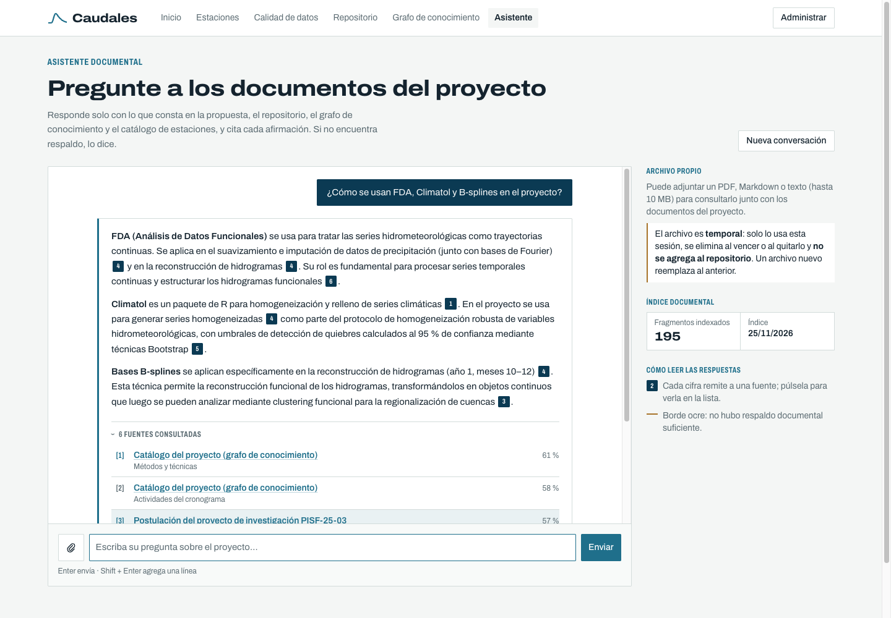
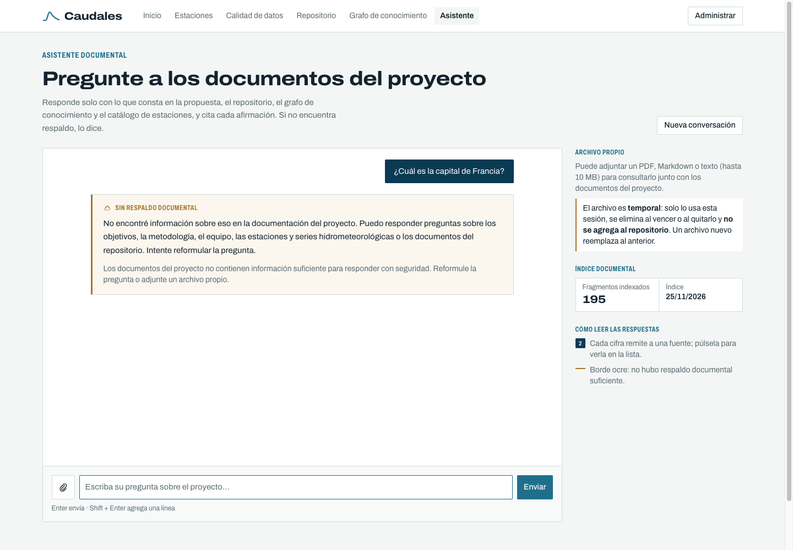
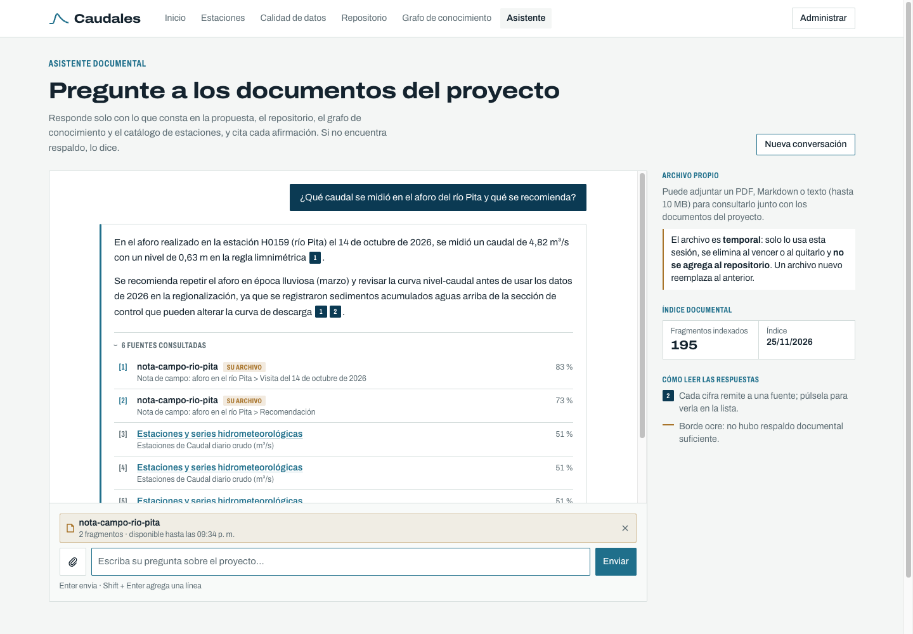

<!-- rag: exclude -->
# INFORME MENSUAL DE PRODUCTOS ENTREGADOS

> Documento corto (formato administrativo). El detalle técnico está en
> `informe-tecnico-producto-3.md` y la evaluación en `evaluacion-rag.md`.
> Campos `[COMPLETAR: ...]` y `[CONFIRMAR]` pendientes.

| Campo | Valor |
|-------|-------|
| **NOMBRE DEL PRODUCTO** | Implementación de un asistente de consulta documental basado en generación aumentada por recuperación (RAG) sobre la documentación del proyecto, con respuestas ancladas en el corpus, fuentes citadas de forma verificable y consulta temporal de archivos propios. [CONFIRMAR: redacción contractual del producto] |
| **CÓDIGO PROYECTO** | PISF-25-03 |
| **NOMBRE DE PROYECTO** | Metodología para la regionalización de caudales en Ecuador basada en el Análisis de Datos Funcionales y la homogeneización de variables hidrometeorológicas |
| **NOMBRE DEL PROFESIONAL** | Kenig Valentín Pico Ponce |
| **PERÍODO** | 01 al 31 de diciembre de 2026 [CONFIRMAR] |
| **FECHA DE PRESENTACIÓN** | [COMPLETAR: fecha de entrega] |

---

## 1. OBJETIVO

Implementar un asistente de consulta documental, integrado a la plataforma web del Producto 1,
que permita interrogar en lenguaje natural la documentación del proyecto —postulación,
informes y catálogo de la base de datos (grafo de conocimiento, repositorio digital y
estaciones)—, con respuestas ancladas en ese corpus, fuentes citadas de forma verificable,
abstención explícita cuando la pregunta no tiene respaldo documental y consulta temporal de
archivos propios.

## 2. ACTIVIDADES REALIZADAS

Durante el período se desarrollaron las siguientes actividades:

1. Diseño de la arquitectura del asistente con el proveedor de modelos detrás de puertos
   (`IEmbedder`, `IChatModel`, `IChunkStore`), y verificación previa de los modelos
   disponibles en Amazon Bedrock para la cuenta del proyecto.
2. Habilitación de la **base vectorial** sobre la misma instancia de PostgreSQL del Producto 1,
   con la imagen `pgvector/pgvector:pg16`, sin infraestructura adicional.
3. Integración de **Amazon Bedrock** como proveedor por omisión (embeddings Cohere Embed
   Multilingual v3 de 1 024 dimensiones y generación con Claude Haiku 4.5) y de **OpenAI
   directo** como alternativa configurable por variable de entorno.
4. Desarrollo de la **canalización de ingestión**: corpus Markdown, extracción fuera de línea
   de la postulación desde PDF con supresión de cédulas y correos, y **proyección del catálogo**
   de la base de datos (grafo de conocimiento, repositorio y estaciones) a documentos
   consultables; indexado idempotente por huella del contenido y del modelo.
5. Implementación de la **fragmentación por encabezados** (ventanas de 1 000 caracteres con 150
   de solapamiento) y de la **recuperación** con diversificación (máximo tres fragmentos por
   sección, ocho en el contexto) y soporte de preguntas de seguimiento.
6. Implementación de la **abstención en dos capas**: umbral de similitud (0,35) que abstiene sin
   llamar al modelo de lenguaje y marca de no respaldo que el modelo emite cuando el contexto no
   sostiene una respuesta.
7. Implementación de la **generación con citas numeradas** y de la respuesta en **flujo
   continuo** (*Server-Sent Events*), con instrucción de sistema en español neutro y trato de
   usted.
8. Implementación de la **consulta temporal de archivos propios** (PDF, Markdown o texto, hasta
   10 MB por archivo), aislada por sesión y con un tope de 600 fragmentos por sesión, con
   vencimiento a los 120 minutos, purga automática y borrado a demanda.
9. **Seguridad y control de costos**: límite de 10 consultas por minuto por IP, puerta de
   administración para el reindexado, aislamiento de sesiones, protección ante instrucciones
   incrustadas en los documentos, límites de pregunta, contexto y respuesta, y deshabilitación
   controlada del asistente (respuesta `503`) si el proveedor de modelos está mal configurado.
10. Desarrollo de la **interfaz de consulta**: página «Asistente» y botón flotante en toda la
    plataforma, preguntas de ejemplo, citas enlazadas a sus fuentes con porcentaje de
    similitud, indicación de abstención y panel del archivo propio.
11. **Evaluación de punta a punta** con 32 preguntas de referencia contra la API real, cuyos
    resultados guiaron los ajustes de recuperación.
12. Revisión de calidad y seguridad, pruebas automatizadas (153 en verde: 106 del backend, 42 del
    frontend y 5 del extractor de PDF), elaboración del informe técnico del producto y control de
    versiones (Git, rama `producto-3`).

## 3. PRODUCTOS ALCANZADOS

Los productos generados durante el presente período incluyen:

### Producto 3 — Asistente de consulta documental (RAG) sobre la documentación del proyecto

El producto entregado es un asistente de consulta integrado a la plataforma web del proyecto
que responde preguntas en lenguaje natural sobre la postulación, los informes y el catálogo de
la base de datos. El asistente recupera los fragmentos pertinentes del corpus, se los entrega
al modelo de lenguaje como único contexto y cita en cada afirmación el fragmento de
procedencia, que la interfaz enlaza a su documento junto con su sección y su similitud con la
pregunta. Cuando la pregunta no tiene respaldo en la documentación, se abstiene de forma
explícita. Un visitante puede adjuntar un archivo propio para consultarlo de forma temporal
junto con la documentación, sin que se incorpore al corpus ni al repositorio. La solución
reutiliza la base de datos del Producto 1, extendida con `pgvector`, y usa Amazon Bedrock como
proveedor de modelos, con OpenAI como alternativa configurable.

**Resultados alcanzados:**

1. Asistente de consulta documental en la página «Asistente» y en un botón flotante presente en
   toda la plataforma, con respuesta en flujo continuo.
2. Respuestas ancladas en el corpus con citas numeradas y fuentes enlazadas a su documento, su
   sección y su porcentaje de similitud.
3. Abstención explícita en dos capas: por umbral, sin llamar al modelo, y por la marca de no
   respaldo del modelo.
4. Corpus de 195 fragmentos: postulación del proyecto, informes del Producto 1 y catálogo
   proyectado desde la base de datos, con indexado idempotente.
5. Consulta temporal de archivos propios aislada por sesión, con vencimiento automático y
   borrado a demanda.
6. Superficie pública protegida: límite por IP, puerta de administración, aislamiento de
   sesiones y protección ante instrucciones incrustadas.
7. Evaluación de punta a punta reproducible y documentación técnica del producto (informe
   técnico, informe de evaluación y diagrama de arquitectura).

**Evaluación del sistema** (32 preguntas, corrida final con Bedrock, 195 fragmentos, umbral
0,35):

| Métrica | Valor |
|---|---|
| Exactitud en preguntas respondibles | 24/24 correctas |
| Precisión de la abstención | 1,00 (8 de 8) |
| Exhaustividad de la abstención | 1,00 (8 de 8) |
| Validez de citas | 24/24 respuestas |
| Latencia total | mediana 1,61 s; p95 2,77 s |

*Tabla 1. Resultados de la evaluación del asistente.*

### Evidencias

## 4. REFERENCIAS

- Escuela Politécnica Nacional. (2025). *Postulación del proyecto: Metodología para la
  regionalización de caudales en Ecuador basada en el Análisis de Datos Funcionales y la
  homogeneización de variables hidrometeorológicas*. Vicerrectorado de Investigación,
  Innovación y Vinculación.
- Lewis, P., Perez, E., Piktus, A., Petroni, F., Karpukhin, V., Goyal, N., et al. (2020).
  Retrieval-Augmented Generation for Knowledge-Intensive NLP Tasks. *Advances in Neural
  Information Processing Systems*, 33.
- Pico Ponce, K. V. (2026). *Informe técnico de implementación de un asistente de consulta
  documental basado en generación aumentada por recuperación (RAG) sobre la documentación del
  proyecto* (Producto 3, PISF-25-03). Escuela Politécnica Nacional.

## 5. CONCLUSIONES

El análisis desarrollado a partir del informe permite concluir lo siguiente:

- El asistente convierte la documentación del proyecto, hasta ahora repartida entre la
  postulación, los informes y las vistas de la plataforma, en información consultable con una
  pregunta en lenguaje natural, sin necesidad de saber de antemano dónde buscar.
- El anclaje documental se sostiene en mecanismos verificables —umbral de similitud, marca de no
  respaldo, instrucción que prohíbe completar con conocimiento externo y citas enlazadas a su
  fuente—, y la evaluación de punta a punta obtuvo 24 de 24 respuestas correctas y una
  abstención sin errores.
- La separación por puertos deja el proveedor de modelos como una decisión de configuración, y
  la reutilización de PostgreSQL con `pgvector` evita infraestructura nueva.
- La consulta de archivos propios y las protecciones de la superficie pública acotan el abuso y
  el costo sin comprometer el corpus ni el repositorio del proyecto.

En conjunto, este producto incorpora a la plataforma del proyecto una **capa de consulta
documental** que permite interrogar en lenguaje natural lo producido por el proyecto, con
trazabilidad de cada respuesta hasta su fuente.

## 6. ACEPTACIÓN

Firma Kenig Valentín Pico Ponce en calidad de Servidor Público 3 (denominación del profesional
descrito en el contrato) del Proyecto PISF-25-03 y la directora del Proyecto Adriana Uquillas
Andrade, en calidad de directora del Proyecto PISF-25-03, para constancia de la recepción de
este producto y su aprobación a entera satisfacción.

| Elaborado por: | Aprobado por: |
|----------------|---------------|
| [COMPLETAR: firma electrónica] | |
| **Nombre:** Kenig Valentín Pico Ponce | **Nombre:** Adriana Uquillas Andrade |
| Servidor Público 3 | Directora del Proyecto PISF-25-03 |
