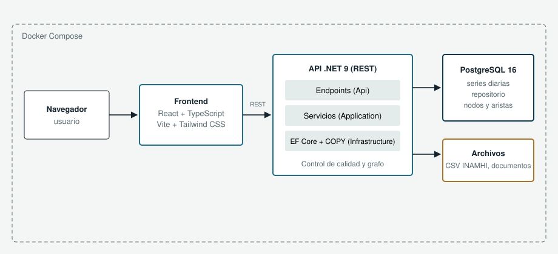
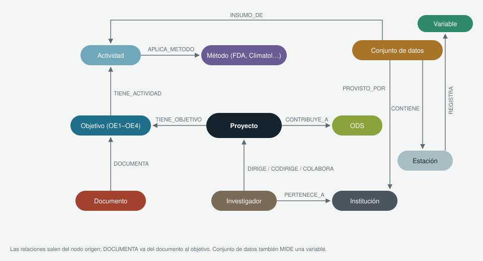
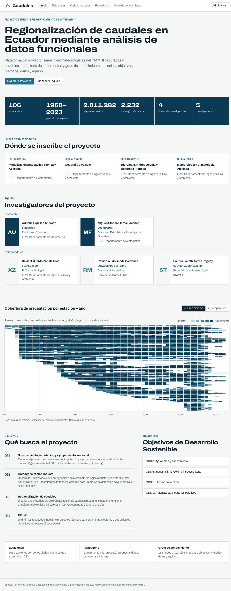
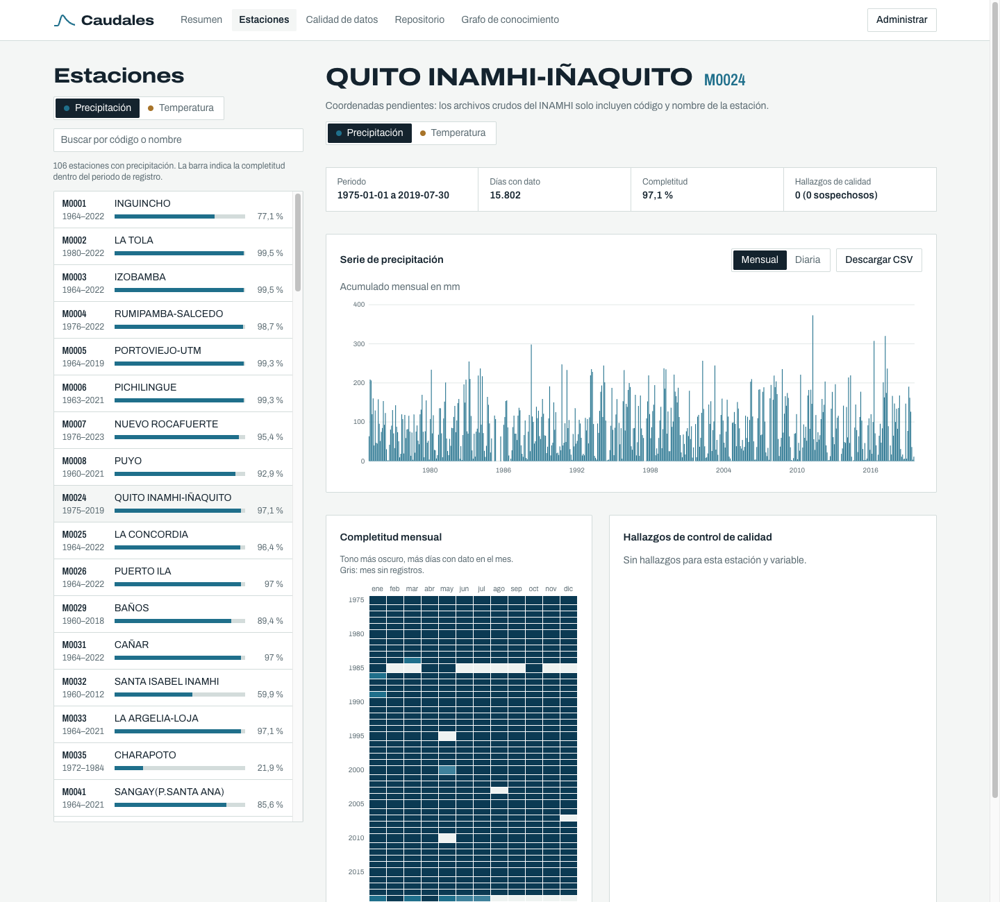
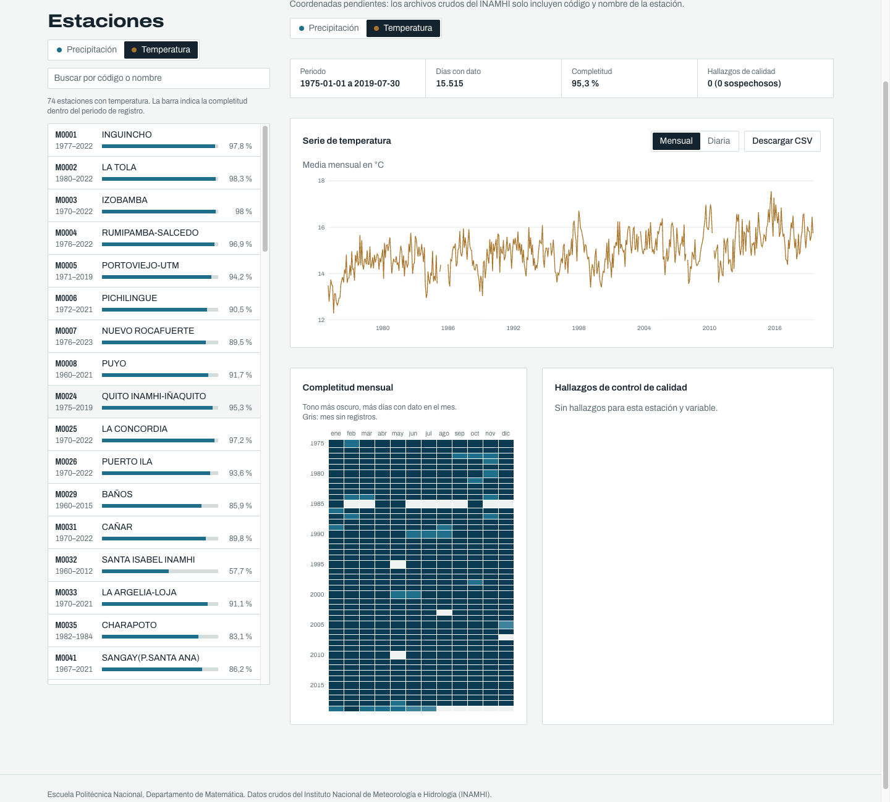
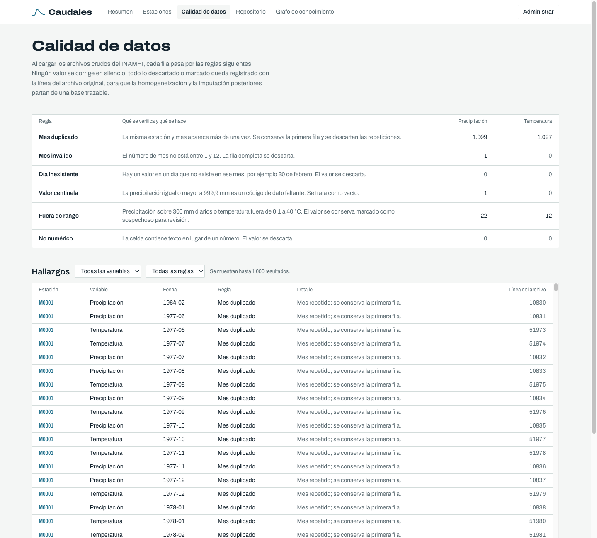
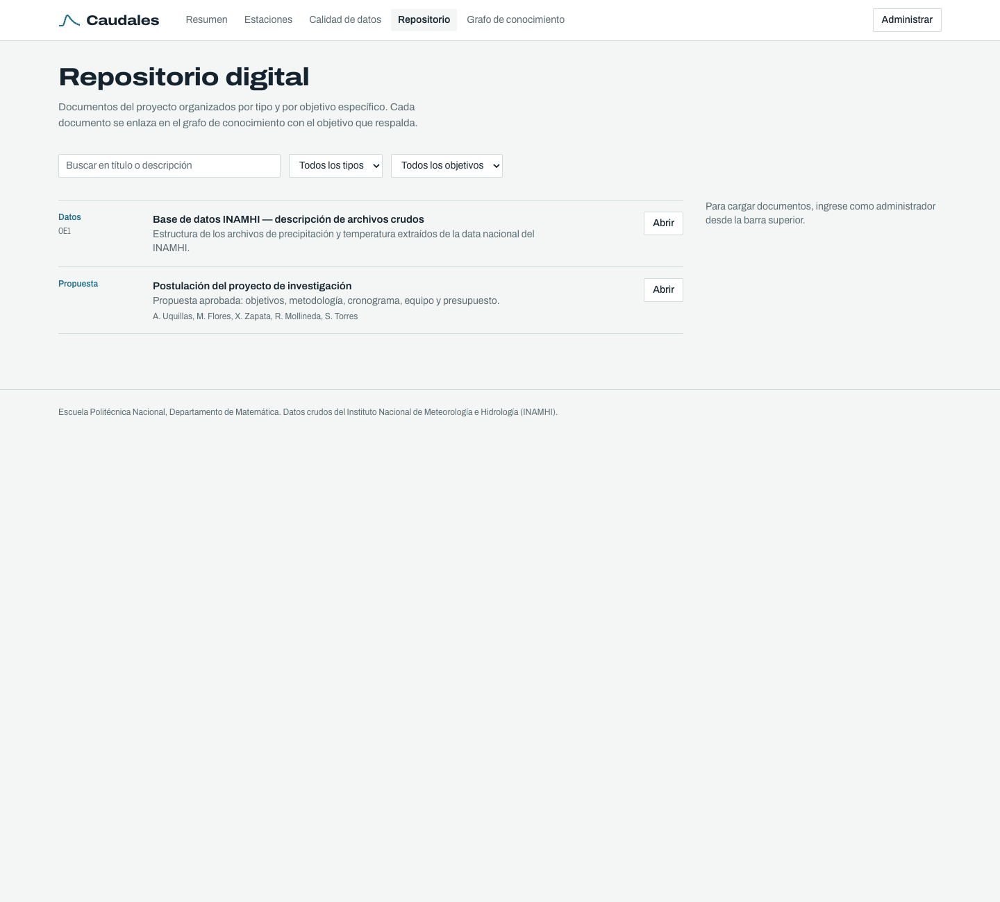
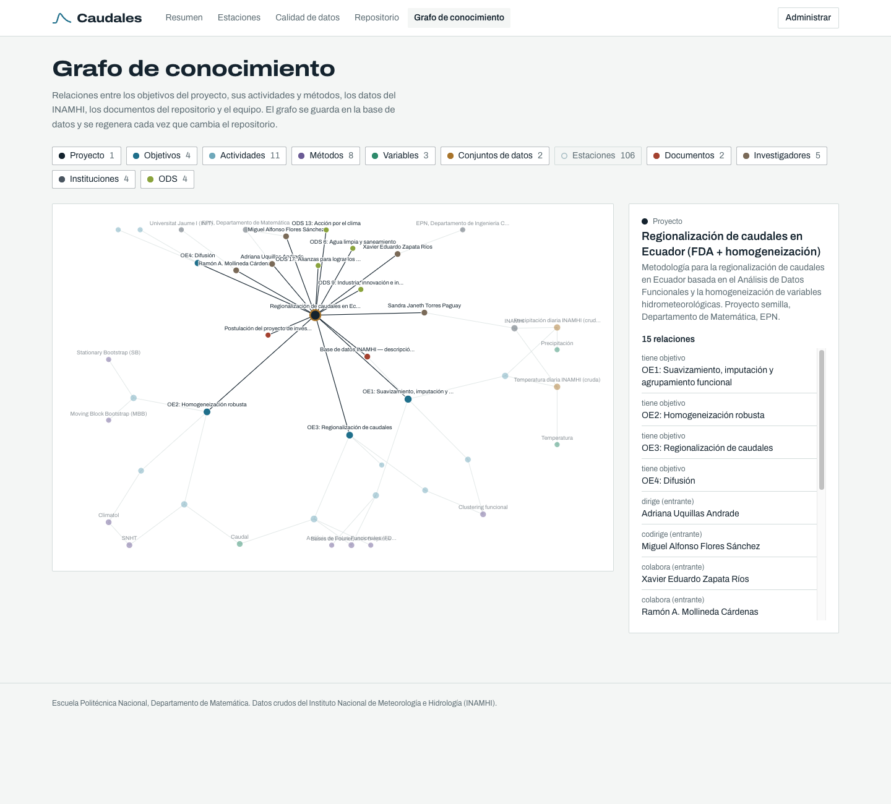

# Implementación de un Aplicativo Web para la Gestión de Series Hidrometeorológicas y Documentación del Proyecto, con Repositorio Digital y Grafo de Conocimiento

**Metodología para la regionalización de caudales en Ecuador basada en el Análisis de Datos Funcionales y la homogeneización de variables hidrometeorológicas**

> Informe técnico — Producto del período del 01 al 31 de octubre de 2026. Los campos
> `[COMPLETAR: ...]` son lo único pendiente.

| | |
|---|---|
| **Código del proyecto** | [COMPLETAR: código del proyecto] |
| **Directora del proyecto** | Adriana Uquillas Andrade |
| **Codirector del proyecto** | Miguel Alfonso Flores Sánchez |
| **Profesional contratado** | Valentin Pico — Ingeniero de Software |
| **Unidad** | Escuela Politécnica Nacional, Departamento de Matemática |
| **Período** | 01 al 31 de octubre de 2026 |
| **Fecha de entrega** | [COMPLETAR: fecha] |

---

## Tabla de contenido

1. Introducción
2. Objetivos
3. Metodología e implementación
4. Resultados
5. Limitaciones y trabajo pendiente
6. Conclusiones
7. Bibliografía
8. Anexos

---

## 1. Introducción

El presente informe describe el diseño e implementación de un aplicativo web para la
gestión de las series hidrometeorológicas y de la documentación del proyecto
*Metodología para la regionalización de caudales en Ecuador basada en el Análisis de
Datos Funcionales y la homogeneización de variables hidrometeorológicas*, ejecutado por
el Departamento de Matemática de la Escuela Politécnica Nacional (EPN) en vinculación con
el Instituto Nacional de Meteorología e Hidrología (INAMHI).

El proyecto parte de un diagnóstico explícito en su propuesta: la baja calidad de las
series hidrometeorológicas del Ecuador —vacíos de información e inhomogeneidades— limita
la planificación hídrica y la resiliencia climática. Su metodología se estructura en tres
fases (suavizamiento, imputación y agrupamiento funcional mediante Análisis de Datos
Funcionales; homogeneización robusta con Climatol y remuestreo Bootstrap; y
regionalización funcional de caudales), y todas ellas dependen de un mismo insumo: series
históricas organizadas, trazables y con su calidad documentada.

En coherencia con la actividad *Levantamiento de datos de series* del primer objetivo
específico, se desarrolló una plataforma web compuesta por tres elementos:

- un **módulo de series hidrometeorológicas** que carga los registros crudos del INAMHI
  —2 011 282 valores diarios de precipitación y temperatura de 106 estaciones entre 1960 y
  2023—, aplica un control de calidad automático y permite consultarlos, visualizarlos y
  exportarlos;
- un **repositorio digital** que organiza la documentación del proyecto por tipo y por
  objetivo específico; y
- un **grafo de conocimiento soportado en base de datos** que relaciona los objetivos,
  actividades, métodos, datos, estaciones, documentos, investigadores e instituciones del
  proyecto.

A diferencia de un repositorio de archivos convencional, la plataforma conserva la
trazabilidad completa del dato: cada valor diario remite a la línea del archivo original
del INAMHI, cada descarte o marca de calidad queda registrado con su motivo, y cada
documento se vincula con el objetivo que respalda. Esta base es el punto de partida de las
etapas de suavizamiento, imputación y homogeneización previstas en el cronograma.

## 2. Objetivos

### Objetivo general

Diseñar e implementar un aplicativo web para la gestión de las series hidrometeorológicas
y de la documentación del proyecto, que integre un repositorio digital y un grafo de
conocimiento soportado en base de datos, garantizando la organización, la trazabilidad y
el control de calidad de la información que alimenta la regionalización de caudales.

### Objetivos específicos

- Diseñar un modelo de datos que represente estaciones, observaciones diarias, hallazgos
  de control de calidad, documentos y el grafo de conocimiento del proyecto.
- Implementar un proceso de carga de los archivos crudos del INAMHI que transforme el
  formato mensual de 31 columnas en observaciones diarias y detecte de forma automática
  las inconsistencias de los datos.
- Desarrollar consultas y visualizaciones de las series (diarias y mensuales), de su
  completitud y de los hallazgos de calidad, con exportación en formato abierto (CSV).
- Implementar un repositorio digital para la documentación del proyecto, organizado por
  tipo de documento y por objetivo específico.
- Generar un grafo de conocimiento soportado en base de datos que relacione los elementos
  metodológicos, los datos y los actores del proyecto.
- Establecer una infraestructura reproducible y probada que sirva de base para las fases
  de suavizamiento, homogeneización y regionalización.

## 3. Metodología e implementación

### 3.1 Arquitectura general

La plataforma se implementó como un **monorepo único** que integra, bajo un mismo control
de versiones, el backend, el frontend, los documentos del repositorio y la documentación
técnica. Así, un cambio que cruza varias capas (por ejemplo, un nuevo indicador que afecta
a la API y a la interfaz) se versiona de forma atómica, y el sistema completo se levanta
con un único comando.

Todo el sistema se ejecuta en **contenedores orquestados con Docker Compose**, de modo que
el entorno es idéntico en desarrollo y en evaluación y no requiere instalar dependencias en
el equipo anfitrión. Se definieron tres servicios:

| Servicio | Rol |
|----------|-----|
| Frontend | Interfaz web (React + TypeScript) servida al navegador |
| API | Backend .NET 9 que expone la API REST, carga los datos y construye el grafo |
| PostgreSQL 16 | Base de datos única: series, hallazgos de calidad, repositorio y grafo |

| Capa | Tecnología |
|------|-----------|
| Backend | .NET 9 (C#), ASP.NET Core Minimal API |
| Acceso a datos | Entity Framework Core + Npgsql (carga masiva con `COPY` binario) |
| Base de datos | PostgreSQL 16 |
| Frontend | React 18 + TypeScript + Vite + Tailwind CSS |
| Pruebas | xUnit + EF Core InMemory (backend), Vitest (frontend) |
| Orquestación | Docker Compose |

El backend sigue una **arquitectura por capas** con dependencias en un solo sentido:

- **Endpoints (`Api`):** reciben la petición HTTP, interpretan sus parámetros y delegan en
  los servicios. No contienen lógica de negocio.
- **Servicios (`Application`):** concentran las reglas del dominio: agregación mensual de
  series, cálculo de completitud, validación de documentos y construcción del grafo.
  Señalan los errores mediante excepciones de dominio.
- **Infraestructura (`Infrastructure`):** encapsula la persistencia (Entity Framework
  Core), el analizador de los archivos del INAMHI y la carga masiva inicial.

El frontend se organiza **por funcionalidades** (*features*): inicio, estaciones,
calidad de datos, repositorio y grafo; cada una agrupa sus componentes, y los elementos
transversales (cliente de la API, formato numérico, controles comunes) residen en una
carpeta compartida.



*Figura 1. Arquitectura de despliegue de la plataforma.*

### 3.2 Modelo de datos

El modelo se compone de seis entidades persistidas en PostgreSQL:

| Entidad | Atributos principales | Observaciones |
|---------|----------------------|---------------|
| `Station` | código INAMHI, nombre, latitud, longitud, altitud, provincia | Las coordenadas son opcionales (ver sección 5) |
| `Observation` | estación, variable, fecha, valor, sospechoso, línea de origen | Clave primaria compuesta (estación, variable, fecha) |
| `QualityIssue` | estación, variable, año, mes, día, tipo de regla, detalle, línea de origen | Un registro por hallazgo de control de calidad |
| `Document` | título, tipo, objetivo (OE1–OE4), descripción, autores, ruta del archivo | Repositorio digital |
| `GraphNode` | identificador estable, tipo, etiqueta, descripción | Nodo del grafo de conocimiento |
| `GraphEdge` | nodo origen, nodo destino, relación | Arista del grafo, única por (origen, destino, relación) |

Tres decisiones de diseño merecen destacarse:

- **Formato largo para las series.** Los archivos del INAMHI almacenan una fila por
  estación y mes con 31 columnas de días. Para el análisis funcional y la homogeneización
  se requiere una serie temporal continua, por lo que cada valor se almacena como una
  observación diaria con fecha real. La clave primaria compuesta (estación, variable,
  fecha) impide duplicados a nivel de base de datos y sirve además como índice para las
  consultas por estación.
- **Trazabilidad al archivo original.** Cada observación y cada hallazgo guarda la
  *línea de origen* del archivo crudo, de modo que cualquier valor puede verificarse
  contra la fuente del INAMHI.
- **Una sola base de datos.** El grafo de conocimiento se persiste en PostgreSQL mediante
  tablas de nodos y aristas con integridad referencial, en lugar de un motor de grafos
  adicional. Con el tamaño del grafo del proyecto (cientos de nodos) las consultas de
  vecindad responden en milisegundos y se evita sincronizar dos motores. Si en etapas
  posteriores se requieren algoritmos de grafos más complejos, el grafo puede proyectarse
  a un motor especializado sin cambiar el modelo.

### 3.3 Carga y control de calidad de las series

Los insumos son los archivos crudos extraídos de la base nacional del INAMHI:

| Archivo | Filas (estación-mes) | Estaciones | Período |
|---------|---------------------|-----------|---------|
| `INAMHI_precipitacion_CRUDA.csv` | 41 501 | 106 | 1960–2023 |
| `INAMHI_temperatura_CRUDA.csv` | 29 925 | 74 | 1960–2023 |

Antes de diseñar la carga se perfilaron los archivos, lo que reveló las inconsistencias
reales que el proceso debía tratar: meses repetidos para una misma estación (copias
exactas), una fila con número de mes 0, un valor centinela de 999,9 mm usado como dato
faltante y valores extremos aislados. Con base en ese perfil se definieron seis reglas de
control de calidad que el analizador aplica fila por fila:

| Regla | Qué se verifica | Acción |
|-------|-----------------|--------|
| Mes duplicado | La misma estación y mes aparece más de una vez | Se conserva la primera fila; las repeticiones se descartan |
| Mes inválido | El número de mes no está entre 1 y 12 | Se descarta la fila completa |
| Día inexistente | Hay valor en un día que no existe en el mes (p. ej., 30 de febrero) | Se descarta el valor |
| Valor centinela | Precipitación ≥ 999,9 mm | Se trata como dato faltante |
| Fuera de rango | Precipitación > 300 mm/día o temperatura fuera de 0,1–40 °C | Se conserva el valor marcado como sospechoso |
| No numérico | La celda contiene texto | Se descarta el valor |

El principio rector es que **ningún valor se corrige en silencio**: lo descartado y lo
marcado queda registrado como hallazgo, con su regla, su detalle y la línea del archivo,
de modo que las etapas de homogeneización e imputación partan de una base auditable. Los
valores fuera de rango no se eliminan porque pueden corresponder a eventos extremos
reales; su revisión corresponde a la fase de homogeneización (OE2).

La carga se ejecuta automáticamente en el primer arranque del sistema. El analizador
transforma las filas mensuales en observaciones diarias y las inserta mediante el
protocolo `COPY` binario de PostgreSQL, adecuado para el volumen de datos (más de dos
millones de filas). Los arranques posteriores detectan que los datos ya existen y no los
recargan. El resultado de la carga es el siguiente:

| Variable | Observaciones diarias | Hallazgos |
|----------|----------------------|-----------|
| Precipitación | 1 205 798 | 1 123 (1 099 meses duplicados, 22 fuera de rango, 1 centinela, 1 mes inválido) |
| Temperatura | 805 484 | 1 109 (1 097 meses duplicados, 12 fuera de rango) |
| **Total** | **2 011 282** | **2 232** |

Sobre las series cargadas, la API calcula para cada estación el período de registro, el
número de días con dato, la **completitud** (días con dato respecto de los días del
período), la cantidad de valores sospechosos y de hallazgos. También ofrece la serie
**mensual** (acumulado para precipitación, media para temperatura, junto con el número de
días que la sustentan), la serie **diaria**, la matriz de completitud por mes y la
exportación en CSV.

### 3.4 Información incorporada

Además de las series, la plataforma se pobló con la información del proyecto tomada de
la propuesta aprobada:

- **Objetivos específicos (4):** OE1 suavizamiento, imputación y agrupamiento funcional;
  OE2 homogeneización robusta; OE3 regionalización de caudales; OE4 difusión.
- **Actividades del cronograma (11):** desde el levantamiento de datos de precipitación
  hasta la redacción de los dos artículos científicos, con su ubicación en el cronograma.
- **Métodos (8):** Análisis de Datos Funcionales (FDA), bases de Fourier, bases B-splines,
  clustering funcional, Climatol, SNHT, Moving Block Bootstrap y Stationary Bootstrap.
- **Variables (3):** precipitación, temperatura y caudal (este último pendiente de datos,
  previsto en el OE2).
- **Equipo (5) e instituciones (4):** directora, codirector y colaboradores; EPN
  (Departamento de Matemática y Departamento de Ingeniería Civil y Ambiental), INAMHI y
  Universitat Jaume I.
- **Líneas de investigación (4):** Modelización Estocástica Teórica y Aplicada
  (LPI-DM-2023-04), Geografía y Paisaje (LI-DICA-2023-01), Hidrología, Hidrogeología y
  Recursos Hídricos (LPI-DICA-2023-01) y Meteorología y Climatología Aplicada
  (LI-DICA-2023-06).
- **Objetivos de Desarrollo Sostenible (4):** ODS 6, 9, 13 y 17.
- **Documentos iniciales del repositorio (2):** la postulación del proyecto y la
  descripción de los archivos crudos del INAMHI.

### 3.5 Grafo de conocimiento

El grafo de conocimiento se almacena en PostgreSQL (tablas `graph_nodes` y `graph_edges`)
y se obtiene por **proyección**: se construye a partir del conocimiento de la propuesta y
de las estaciones, conjuntos de datos y documentos presentes en la base de datos. Las
relaciones modeladas son:

```
(Proyecto)-[TIENE_OBJETIVO]->(Objetivo)
(Objetivo)-[TIENE_ACTIVIDAD]->(Actividad)
(Actividad)-[APLICA_METODO]->(Método)
(Actividad)-[ANALIZA]->(Variable)
(Método)-[USA]->(Método)                       Climatol usa SNHT
(Conjunto de datos)-[MIDE]->(Variable)
(Conjunto de datos)-[PROVISTO_POR]->(Institución)
(Conjunto de datos)-[INSUMO_DE]->(Actividad)
(Conjunto de datos)-[CONTIENE]->(Estación)
(Estación)-[REGISTRA]->(Variable)
(Documento)-[PERTENECE_A]->(Proyecto)
(Documento)-[DOCUMENTA]->(Objetivo)
(Investigador)-[DIRIGE | CODIRIGE | COLABORA]->(Proyecto)
(Investigador)-[PERTENECE_A]->(Institución)
(Proyecto)-[CONTRIBUYE_A]->(ODS)
(Proyecto)-[EN_LINEA]->(Línea de investigación)
(Línea de investigación)-[DEFINIDA_POR]->(Institución)
```

En su estado actual el grafo contiene **154 nodos y 419 relaciones**. Al ser una
proyección, se **reconstruye automáticamente** al iniciar el sistema y ante cada alta o
baja en el repositorio, por lo que nunca diverge de los datos: un documento nuevo
asociado al OE2 aparece de inmediato enlazado a ese objetivo y, a través de él, a sus
actividades y métodos. La API expone el grafo completo y la vecindad de cualquier nodo,
lo que permite recorrer preguntas como *¿qué métodos aplica el OE2?*, *¿qué estaciones
registran temperatura?* o *¿qué documentos respaldan la homogeneización?*.



*Figura 2. Tipos de nodo y relaciones del grafo de conocimiento.*

### 3.6 Repositorio digital y buenas prácticas

- **Código:** versionado en Git con commits atómicos según *Conventional Commits*.
- **Documentos:** almacenados en `data/documentos/` y servidos por la API en la ruta
  `/files`. Cada documento se clasifica por tipo (propuesta, datos, informe, protocolo,
  código, artículo) y, cuando corresponde, por objetivo específico. Los archivos cargados
  reciben un prefijo único para evitar colisiones de nombres, y solo se aceptan formatos
  documentales y de datos (PDF, DOCX, XLSX, CSV, Markdown, texto, notebooks, scripts R y
  Python, ZIP e imágenes).
- **Datos crudos:** los archivos del INAMHI se mantienen fuera del control de versiones,
  por su tamaño, y se montan en modo solo lectura; la plataforma nunca los modifica.
- **Coordenadas de estaciones:** el sistema admite un archivo opcional
  `data/estaciones.csv` (código, latitud, longitud, altitud, provincia) que se aplica en
  el arranque, de modo que la ubicación puede incorporarse sin cambios de código.
- **Documentación técnica:** README con instrucciones de ejecución, diagramas y el presente
  informe, versionados junto al código.

### 3.7 Interfaz web

La interfaz se diseñó a partir del propio objeto de estudio. Su paleta proviene del
trabajo con registros hidrometeorológicos —fondo de papel milimetrado, azul de río para
la precipitación y ocre de sedimento para la temperatura y los valores sospechosos— y se
emplea una única familia tipográfica de ancho variable: en versión expandida para los
títulos y condensada para los códigos de estación y las tablas densas. Los gráficos se
dibujan directamente en SVG, sin bibliotecas externas, lo que permite representar los
vacíos del registro como vacíos y no como interpolaciones. La aplicación se organiza en
cinco secciones:

- **Inicio:** es la portada del proyecto. Presenta el título y el propósito de la
  plataforma, una banda de cifras (estaciones, período, registros, hallazgos de calidad,
  líneas de investigación e investigadores), las cuatro **líneas de investigación**, el
  **equipo** agrupado en dirección y colaboradores, con su rol, título e institución, una
  **matriz de cobertura** de la red:
  cada fila es una estación, ordenada por el inicio de su registro, y cada columna un año;
  el tono indica la proporción de días con dato. En una sola imagen se observa el
  crecimiento de la red en las décadas de 1960 a 1980, los vacíos de cada estación y la
  disminución de registros en los últimos años. Al pasar el cursor se identifica la
  estación y el año, y con un clic se abre su serie; y, por último, los cuatro objetivos
  específicos y los ODS. La información del proyecto se obtiene del grafo de conocimiento,
  de modo que no existe una segunda fuente de datos que mantener.
- **Estaciones:** lista buscable con el período y la completitud de cada estación; al
  seleccionarla se muestran sus indicadores, la serie mensual o diaria con marca de
  valores sospechosos, la matriz de completitud mes a mes, sus hallazgos de calidad y la
  descarga en CSV.
- **Calidad de datos:** describe cada regla de control, su conteo por variable y el
  listado filtrable de hallazgos con la línea del archivo original.
- **Repositorio:** documentos filtrables por tipo, objetivo y texto; en modo administrador
  permite cargar y eliminar documentos.
- **Grafo de conocimiento:** visualización interactiva con filtro por tipo de nodo y un
  panel de detalle que lista las relaciones del nodo seleccionado y permite navegar de un
  nodo a otro.

### 3.8 Seguridad y administración

La plataforma opera en **modo lectura pública**: la consulta de series, calidad,
repositorio y grafo no requiere autenticación, mientras que toda operación de escritura
está restringida:

- Toda mutación (`POST`/`PUT`/`DELETE`) bajo `/api` exige una contraseña de administrador
  en una cabecera HTTP, verificada **del lado del servidor**; si no es correcta, la API
  responde `401 Unauthorized`.
- La contraseña se configura por variable de entorno (`ADMIN_PASSWORD`) y la API no
  arranca si no la recibe, de modo que el código no contiene una credencial embebida. El
  archivo de Docker Compose de desarrollo define un valor de respaldo que debe
  reemplazarse en cualquier despliegue.
- Los nombres de archivo enviados por el cliente se normalizan para descartar rutas, y la
  extensión se valida contra una lista de formatos permitidos.
- Los errores de dominio se traducen de forma centralizada a respuestas coherentes
  (`400` validación, `404` no encontrado, `409` conflicto) sin exponer detalles internos.

### 3.9 Pruebas

Se aplicó **desarrollo guiado por pruebas** en la lógica crítica, con el ciclo *rojo →
verde → refactor*. Las pruebas del analizador de archivos del INAMHI se escribieron antes
de su implementación y se observó su fallo inicial (11 pruebas en rojo) antes de
implementarlo. Las suites actuales son:

- **Backend (xUnit + EF Core InMemory), 31 pruebas:** expansión de filas mensuales a
  observaciones diarias, cada una de las seis reglas de calidad (incluido que una
  precipitación de 0,0 mm es un día seco válido y no un error), agregación mensual
  (suma para precipitación, media para temperatura), filtros por fecha, completitud por
  mes y por año, resumen por estación, exportación CSV, validaciones del repositorio,
  almacenamiento y eliminación de archivos, y construcción, idempotencia y vecindad del
  grafo de conocimiento.
- **Frontend (Vitest), 12 pruebas:** escala de colores de cobertura, cálculo de marcas
  de los ejes, años bisiestos y el algoritmo de disposición del grafo (límites,
  determinismo y cercanía de nodos enlazados) y la lectura del equipo y las líneas de
  investigación desde el grafo.

Las pruebas no dependen de servicios externos y se ejecutan en segundos.

### 3.10 Validación operativa

El entorno completo se levantó con `docker compose up` y se verificó con los datos reales:

- La carga produjo 2 011 282 observaciones y 2 232 hallazgos, coincidentes con el perfil
  previo de los archivos (por ejemplo, 1 099 y 1 097 meses duplicados).
- Tiempos de respuesta medidos en el entorno local: listado de estaciones con sus
  indicadores, 0,11 s; serie mensual completa de una estación, 0,51 s; matriz de
  completitud, 0,01 s; grafo completo, 0,01 s.
- Flujo de punta a punta del repositorio: carga de un documento con objetivo OE2,
  verificación de su enlace en el grafo, descarga del archivo y eliminación (el archivo
  y el nodo desaparecen).
- Una mutación sin contraseña es rechazada con `401`, y una variable inexistente con
  `400` y un mensaje explicativo.

### 3.11 Proceso de desarrollo

- Perfilado de los datos crudos antes de escribir código, para que las reglas de calidad
  respondan a problemas observados y no supuestos.
- Monorepo con Git y *Conventional Commits*, desarrollado en una rama por producto.
- Infraestructura como código con Docker Compose.
- Arquitectura por capas en el backend y por funcionalidades en el frontend.
- Pruebas automatizadas para la lógica de negocio y verificación visual de la interfaz
  sobre los datos reales.

## 4. Resultados

El resultado del producto es un aplicativo web funcional que integra las series
hidrometeorológicas del INAMHI con su control de calidad, el repositorio digital y el
grafo de conocimiento del proyecto. A continuación se presentan sus vistas principales.

### 4.1 Página de inicio: proyecto, equipo y cobertura de la red



*Figura 3. Página de inicio con el proyecto, su equipo y la matriz de cobertura de la red de precipitación.*

La portada reúne la información institucional del proyecto: las cuatro líneas de
investigación de los departamentos de Matemática e Ingeniería Civil y Ambiental y el
equipo de cinco investigadores (directora, codirector y colaboradores de la EPN, la
Universitat Jaume I y el INAMHI). Solo se publican nombre, rol, título e institución de
cada integrante.

La matriz de cobertura resume en una sola vista la disponibilidad de datos de las 106
estaciones de precipitación a lo largo de 64 años. Es el diagnóstico de partida para el
OE1: muestra qué estaciones y períodos tienen registros suficientes para el suavizamiento
funcional y dónde la imputación será necesaria.

### 4.2 Serie de una estación



*Figura 4. Serie mensual de precipitación de la estación M0024 Quito INAMHI-Iñaquito.*

Para cada estación se muestran el período de registro, los días con dato, la completitud
y los hallazgos de calidad, junto con la serie mensual o diaria. Los vacíos del registro
se representan como vacíos, sin interpolación, y los valores sospechosos se distinguen
por color. Los datos pueden descargarse en CSV para su procesamiento en R o Python.

### 4.3 Temperatura y completitud mensual



*Figura 5. Serie de temperatura media mensual y matriz de completitud de la estación M0024.*

La matriz de completitud mes a mes localiza con precisión los vacíos del registro de
cada estación. En el ejemplo, la serie de temperatura de Quito entre 1975 y 2019 tiene
una completitud de 95,3 % y concentra sus vacíos en pocos meses identificables.

### 4.4 Calidad de datos



*Figura 6. Reglas de control de calidad, conteos y listado de hallazgos.*

Esta vista documenta qué se verificó durante la carga y qué se hizo con cada caso. Cada
hallazgo remite a la línea del archivo crudo, lo que permite revisar con el INAMHI los
casos dudosos.

### 4.5 Repositorio digital



*Figura 7. Repositorio digital del proyecto.*

El repositorio organiza la documentación por tipo y objetivo específico, y cada documento
queda enlazado en el grafo de conocimiento. Actualmente contiene la postulación del
proyecto y la descripción de los datos crudos; los productos siguientes del proyecto se
incorporarán a medida que se generen.

### 4.6 Grafo de conocimiento



*Figura 8. Grafo de conocimiento del proyecto.*

El grafo integra de forma navegable los objetivos, actividades y métodos del proyecto
con los datos, las estaciones, los documentos y el equipo. La vista permite ocultar o
mostrar tipos de nodo (por defecto se ocultan las 106 estaciones para facilitar la
lectura) y consultar las relaciones de cada nodo en el panel lateral.

## 5. Limitaciones y trabajo pendiente

- **Ubicación de las estaciones.** Los archivos crudos solo incluyen código y nombre de
  estación. La plataforma ya admite latitud, longitud, altitud y provincia mediante
  `data/estaciones.csv`; falta obtener ese catálogo del INAMHI para habilitar la
  visualización geográfica, necesaria para comparar la regionalización funcional con la
  proximidad geográfica.
- **Datos de caudal.** La variable caudal está modelada en el grafo, pero sus series se
  levantan en el OE2 (meses 7 y 8 del cronograma). El modelo de datos admite nuevas
  variables sin cambios estructurales.
- **Umbrales de rango.** Los límites para marcar valores sospechosos (300 mm diarios;
  0,1 a 40 °C) son conservadores y globales. Deberán ajustarse por región climática una
  vez definidas las regiones homogéneas del OE1.
- **Documentación.** El repositorio contiene por ahora los documentos iniciales; se irá
  completando con protocolos, scripts y productos del proyecto.
- **Despliegue.** El sistema está validado en entorno local con Docker Compose;
  [COMPLETAR: despliegue en servidor institucional, si corresponde].

## 6. Conclusiones

- La plataforma centraliza en una sola base de datos los 2 011 282 registros diarios de
  precipitación y temperatura del INAMHI, la documentación y el grafo de conocimiento del
  proyecto, con **trazabilidad completa** desde cada valor hasta la línea del archivo
  original.
- El control de calidad automático detectó y documentó 2 232 inconsistencias reales
  —principalmente meses duplicados— sin alterar en silencio ningún valor, lo que provee
  una base auditable para el suavizamiento, la imputación y la homogeneización.
- La matriz de cobertura y las matrices de completitud por estación ofrecen el
  diagnóstico de disponibilidad de datos que el OE1 requiere para seleccionar estaciones
  y períodos y para planificar la imputación.
- El grafo de conocimiento, al proyectarse desde la propia base de datos, relaciona de
  forma siempre actualizada los objetivos, actividades, métodos, datos, documentos y
  actores del proyecto.
- La arquitectura por capas, la ejecución en contenedores y las pruebas automatizadas
  aseguran reproducibilidad y mantenibilidad, y permiten incorporar en las siguientes
  fases las series de caudal, las series homogeneizadas y los resultados de la
  regionalización.
- [COMPLETAR: conclusión adicional propia, si corresponde]

## 7. Bibliografía

- Escuela Politécnica Nacional. (2025). *Postulación del proyecto: Metodología para la
  regionalización de caudales en Ecuador basada en el Análisis de Datos Funcionales y la
  homogeneización de variables hidrometeorológicas*. Vicerrectorado de Investigación,
  Innovación y Vinculación.
- Instituto Nacional de Meteorología e Hidrología (INAMHI). *Registros diarios de
  precipitación y temperatura de la red nacional de estaciones, 1960–2023* (archivos
  crudos extraídos de la data nacional).
- Ramsay, J. O., & Silverman, B. W. (2005). *Functional Data Analysis* (2.ª ed.).
  Springer.
- Guijarro, J. A. (2018). *Homogenization of climatic series with Climatol*. Agencia
  Estatal de Meteorología (AEMET).
- Alexandersson, H. (1986). A homogeneity test applied to precipitation data. *Journal
  of Climatology*, 6(6), 661–675.
- Politis, D. N., & Romano, J. P. (1994). The stationary bootstrap. *Journal of the
  American Statistical Association*, 89(428), 1303–1313.
- Künsch, H. R. (1989). The jackknife and the bootstrap for general stationary
  observations. *The Annals of Statistics*, 17(3), 1217–1241.
- [COMPLETAR: otras referencias]

## 8. Anexos

### Anexo 1 — Diagramas

- **Figura 1, arquitectura de despliegue:** `docs/diagramas/arquitectura-despliegue.svg`.
- **Figura 2, grafo de conocimiento:** `docs/diagramas/grafo-conocimiento.svg`.

### Anexo 2 — Endpoints de la API

| Método | Ruta | Descripción |
|--------|------|-------------|
| GET | `/api/overview` | Totales de estaciones, observaciones, hallazgos, documentos y grafo |
| GET | `/api/stations?variable=` | Estaciones con período, completitud y hallazgos |
| GET | `/api/stations/{código}/series?variable=&resolution=daily\|monthly&from=&to=` | Serie diaria o mensual |
| GET | `/api/stations/{código}/completeness?variable=` | Días con dato por mes |
| GET | `/api/stations/{código}/export?variable=` | Descarga CSV de la serie diaria |
| GET | `/api/coverage?variable=` | Días con dato por estación y año |
| GET | `/api/quality/summary` | Conteo de hallazgos por variable y regla |
| GET | `/api/quality/issues?station=&variable=&kind=` | Listado de hallazgos |
| GET | `/api/documents?category=&objective=&search=` | Documentos del repositorio |
| POST | `/api/documents` | Carga de documento (administrador) |
| DELETE | `/api/documents/{id}` | Eliminación de documento (administrador) |
| GET | `/api/graph` | Grafo completo (nodos y aristas) |
| GET | `/api/graph/nodes/{id}` | Nodo y sus vecinos |
| GET | `/files/{ruta}` | Descarga de archivos del repositorio |

### Anexo 3 — Ejecución y pruebas

```bash
# Levantar el sistema (los CSV del INAMHI deben estar en info/)
cp env.example .env          # definir ADMIN_PASSWORD
docker compose up --build    # aplicativo en http://localhost:5174

# Pruebas
cd backend/tests && dotnet test     # 31 pruebas
cd frontend && npm test             # 12 pruebas
```

### Anexo 4 — Repositorio

- **Código fuente:** [COMPLETAR: URL del repositorio]
- **Plataforma desplegada:** [COMPLETAR: URL, si corresponde]
